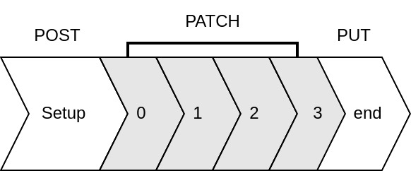

# FHIR examples

Example requests of the FASS-ECG API, whose streaming-like request sequence CardIoT implements to transmit an ECG incrementally (Section 3.3.2 of the article). The structure of the `Observation` generated by CardIoT is shown in Fig. 6 of the article.

| Step | Request | Body |
|---|---|---|
| 1. Setup | `POST [base]/Observation` | [`post-ecg-3-leads.json`](post-ecg-3-leads.json): `Observation` with status `preliminary` and one component per lead |
| 2. Append samples (repeated) | `PATCH [base]/Observation/[id]` | [`patch-ecg-3-leads.json`](patch-ecg-3-leads.json): JSON Patch that appends samples to the `data` of each lead |
| 3. End | `PUT [base]/Observation/[id]` | [`put-ecg-status-final.json`](put-ecg-status-final.json): sets the status to `final` |

`[base]` is the FHIR base URL of the FASS-ECG server (`/baseR4` in the deployment used in the article), and `[id]` is the identifier returned by the server in response to the POST.

The examples use three leads and short placeholder sample values. This request sequence is defined by the FASS-ECG API and was tested only with FASS-ECG.
